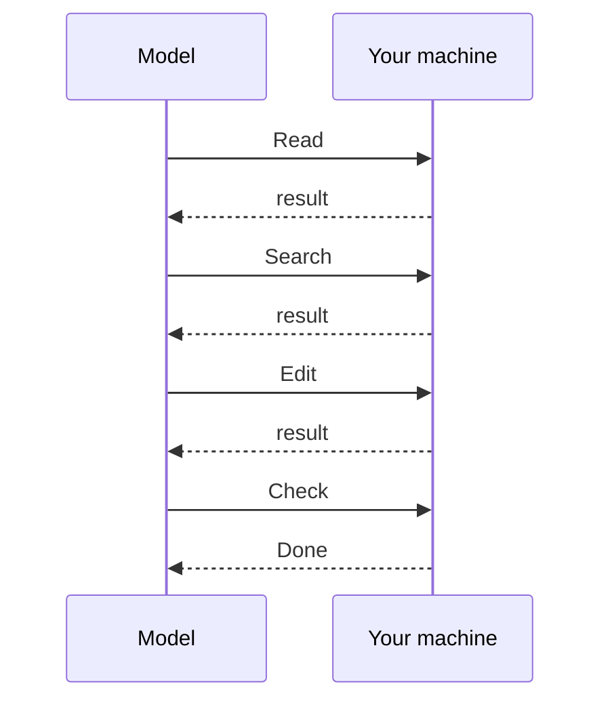
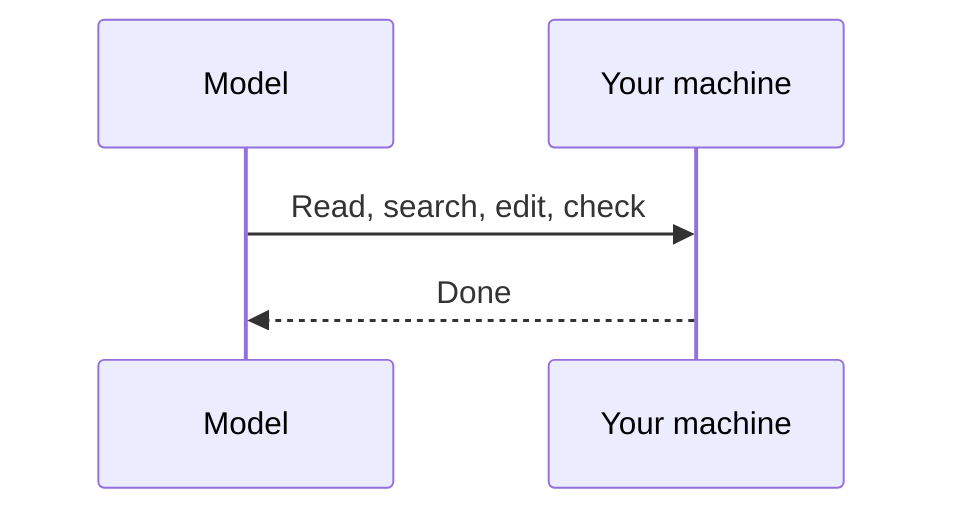

<p align="center">
  
</p>

<p align="center">
  <a href="https://marketplace.visualstudio.com/items?itemName=Unharnessed.unharnessed-agent"></a>
  <a href="#built-with"></a>
  <a href="#built-with"></a>
  <a href="#built-with"></a>
  <a href="#your-plan"></a>
  <a href="LICENSE"></a>
</p>

<h3 align="center">A new generation of harness.</h3>

<p align="center">
  <b>One tool: a Python REPL. The model writes the rest.</b>
</p>

<p align="center">
  <a href="https://marketplace.visualstudio.com/items?itemName=Unharnessed.unharnessed-agent"><b>Install in VS Code</b></a>
  &nbsp;·&nbsp;
  <a href="#quick-start"><b>Quick start</b></a>
  &nbsp;·&nbsp;
  <a href="#terminal-bench-40"><b>Benchmark</b></a>
  &nbsp;·&nbsp;
  <a href="LICENSE"><b>MIT License</b></a>
</p>

<p align="center">
  <code>rust</code> · <code>python kernel</code> · <code>vs code</code> · <code>acp</code> · <code>mcp</code> · <code>open source</code>
</p>

---

## Contents

- [Terminal-Bench 4.0](#terminal-bench-40): higher score, lower bill
- [The bet](#the-bet): the more capable the model, the less harness it needs
- [One tool](#one-tool): a Python session that stays open
  - [1. One call does the work of many](#1-one-call-does-the-work-of-many)
  - [2. What it reads stays in Python, not in its context](#2-what-it-reads-stays-in-python-not-in-its-context)
  - [3. It writes the functions it needs](#3-it-writes-the-functions-it-needs)
  - [4. The context gets compacted. The session carries on.](#4-the-context-gets-compacted-the-session-carries-on)
- [Code mode](#code-mode): code mode calls the tools it was given; here the model writes its own
- [Left out](#left-out): what we didn't build
- [Your plan](#your-plan): use the subscription you already pay for
- [Quick start](#quick-start) · [Built with](#built-with) · [License](#license)

---

## Terminal-Bench 4.0

### Higher score. Lower bill.

Same model, different harness: with **Claude Opus 5.5**, Unharnessed passes **47 of the 66 tasks** of Terminal-Bench 4.0.
Each point of the chart is one run: its score against what a task cost.

| Harness | Model | Tasks passed |
|---|---|:---:|
| **Unharnessed** | Claude Opus 5.5 | **47 / 66** |
| Claude Code, Codex | top 5 models | see the chart |

> [!NOTE]
> Placeholder data: the full run, with every turn, is being published.

---

## The bet

### The more capable the model, the less harness it needs.

Every hardcoded tool is a decision made in advance, on the model's behalf: what a read returns, how an edit is shaped, how much output survives.
That was a fair trade when models needed rails. Each generation needs fewer.

Unharnessed is built for where that curve ends: **one tool, and nothing left to take away.**

```text
 harness needed
   ▲
   │  ████
   │  ████  ████
   │  ████  ████  ████
   │  ████  ████  ████  ████
   │  ████  ████  ████  ████  ▁▁▁▁  ← Unharnessed: one tool
   └──────────────────────────────────▶ model capability
      less capable            next generation
```

---

## One tool

### One tool: a Python session that stays open.

The model gets exactly one tool, `ipython`: a persistent CPython REPL, where top-level `await` works.
Everything else the agent can do is a Python function inside that REPL.

### 1. One call does the work of many.

Frontier models reach for Python anyway. With a tool list, each call does one thing and costs a round trip: the model waits for the result, reads it, then makes the next.
Here one call is a script: read a file, search the repository, change forty places, check the result. **Fewer round trips, fewer turns.**

<table>
<tr>
<th width="50%">With a tool list: 4 round trips</th>
<th width="50%">Unharnessed: 1 round trip</th>
</tr>
<tr>
<td valign="top">



</td>
<td valign="top">



</td>
</tr>
</table>

### 2. What it reads stays in Python, not in its context.

With tool calls, every result is poured into the context and stays there: read a long log, and the model carries it for the rest of the task.
Here the log lands in the session, **under a name**. The model looks at the ten lines it needs and the rest stays within reach.

The session is a kernel, like Jupyter's: it stays alive between calls, and so do its variables. A server the model starts keeps running there too.

| | Server log | In the Python session | In the model's context |
|---|---|---|---|
| With a tool list | 40,000 lines | nothing kept | **all 40,000 lines** |
| **Unharnessed** | 40,000 lines | **kept, under a name** | **the 10 lines it needed** |

```python
# what one call looks like
log = open("server.log").read().splitlines()   # 40,000 lines, kept in the session
errors = [l for l in log if "ERROR" in l]
errors[-10:]                                    # the only thing the model reads
```

### 3. It writes the functions it needs.

Not new tools: plain Python functions, kept as variables in the session. The model calls one again whenever it needs it, rewrites it or deletes it, like any other variable.

Run across 200 files, that is **one loop in one call**. A fixed tool list takes 200 calls, and puts 200 results in the context.

| | Calls | Kept in the session | In the model's context |
|---|:---:|---|---|
| With a tool list | 200 | nothing | 200 results |
| **Unharnessed** | **1** | `find_flaky_tests`, a variable | **3 flaky tests** |

```python
def find_flaky_tests(paths):
    ...                       # written once, kept in the session

flaky = find_flaky_tests(test_files)   # 200 files, one call
flaky                                   # → 3 flaky tests
```

### 4. The context gets compacted. The session carries on.

A long task outgrows the context, and the harness has to summarise it. What lived only in the conversation is gone.
What lives in the session is still there: **the data, the running server, the functions it wrote**. Resume the session another day and the data and the functions come back.

| After compaction | With a tool list | Unharnessed |
|---|---|---|
| Model's context | a summary; the rest is gone | a summary of what it looked at |
| Outside the context | nothing kept | server log, test results, dev server, `find_flaky_tests`: **still there** |

---

## Code mode

### Code mode calls the tools it was given. Here the model writes its own.

Droid, Pi, Codex and Reason now let the model write a script. But that script only calls the tools the harness already built: the same fixed list, called from code.

Here there is no list to call. The model writes the code that does the work, and keeps what it wrote as functions for the next time.

<table>
<tr>
<th width="50%">Code mode: 8 calls, 4 tools</th>
<th width="50%">Unharnessed: 3 functions written</th>
</tr>
<tr>
<td valign="top">

**Built by the harness**
`Read` · `Search` · `Edit` · `Run`

**The script**
```text
Read → Search → Read → Edit
     → Run → Search → Edit → Run
```

The same four tools, in any order.

</td>
<td valign="top">

**Written by the model**
```python
find_flaky_tests(...)
rename_symbol(...)
compare_logs(...)
```

Whatever the task needs.

</td>
</tr>
</table>

---

## Left out

### What we didn't build.

<details open>
<summary><b>No sub-agents</b></summary>
<br>

To hand work to a sub-agent, the main model has to write it a brief, and a brief is never the whole task. The sub-agent starts from zero, spends tokens finding out what the first model already knew, then sends back a summary of what it found. Something is lost at each hand-off.

Here, the model that holds your task makes every call itself. What it needs to know, it reads first-hand.

</details>

<details open>
<summary><b>No memory</b></summary>
<br>

A memory is the agent keeping notes about you from one session to the next. The notes pile up and are loaded every time, so they take context whether they matter or not. And they don't expire when you change your mind: the old preference is still in there, arguing with what you ask today.

Here, a new session starts from your repository and your request. What should always hold, you write yourself in `AGENTS.md`, where you can read it and delete it.

</details>

<details open>
<summary><b>No permission prompts</b></summary>
<br>

Most harnesses stop before a command and wait for you to approve it. Nothing moves until you are back at the screen.

Unharnessed never blocks a call, so a goal can run on its own. It is a bet, taken early: models keep getting better at judging what is safe to run, and a harness built around asking would have to be taken apart later. Today it is the riskier choice; until the bet is won, **run it in a container**.

</details>

<details open>
<summary><b>A minimal system prompt</b></summary>
<br>

Every rule in a system prompt is a decision made for the model, and it sits in the context on every turn.

Ours says what the one tool is and how to use it, once. The rest of the room is the model's.

</details>

<details open>
<summary><b>Async by default</b></summary>
<br>

In most harnesses, a command holds the model until it ends: a ten-minute build is ten minutes of waiting.

Here every command starts in the background and hands back a handle. The model keeps working, and is told when the command is done.

```python
build = bash("cargo build --release")   # returns at once
...                                      # the model keeps working
# a notification arrives when the build ends
```

</details>

---

## Your plan

### Use the subscription you already pay for.

Unharnessed is **free**. Sign in with your browser, from the panel, and requests draw on your plan's limits: no API key to create, no second bill.

| Provider | Plan |
|---|---|
| **Claude** | Pro / Max |
| **ChatGPT** | Plus / Pro |
| **GitHub Copilot** | Your Copilot plan |
| **Google AI** | Pro / Ultra |
| **Grok** | xAI account |
| **Unharnessed** | Free and open source |

<details>
<summary><b>Or bring a key</b>: API keys and cloud accounts</summary>
<br>

Anthropic · OpenAI · Google Gemini · Google Vertex AI · Amazon Bedrock · Azure OpenAI · Mistral · xAI · DeepSeek · Groq · Cerebras · Fireworks · Hugging Face · OpenRouter · Vercel AI Gateway · Cloudflare AI Gateway · Cloudflare Workers AI · Moonshot AI · Kimi For Coding · MiniMax · ZAI · Xiaomi MiMo · OpenCode Zen · OpenCode Go · Prime Inference

</details>

<details>
<summary><b>Or run it yourself</b>: model servers on your machine</summary>
<br>

Ollama · LM Studio · llama.cpp · vLLM · any OpenAI-compatible server

</details>

---

## Quick start

**VS Code:** install [Unharnessed Agent](https://marketplace.visualstudio.com/items?itemName=Unharnessed.unharnessed-agent) from the Marketplace, open the panel and sign in.

**From source:**

```bash
cargo build --release -p uh-cli --bin unharnessed
./target/release/unharnessed --unharnessed-bootstrap   # build the kernel venv

unharnessed -p "Compute 2**100 in the kernel"           # headless, text output
unharnessed --mode json -p "..."                        # JSON event stream
unharnessed -c -p "..."                                 # continue the last session
unharnessed --mode acp                                  # Agent Client Protocol over stdio
```

> [!WARNING]
> The agent runs model-written Python and shell commands with your user permissions, and never asks first.
> The kernel is **not** a sandbox: run it in a container or a disposable checkout.

---

## Built with

| | |
|---|---|
| **Rust** | the harness, the CLI and the providers |
| **Python** | the persistent kernel the model works in |
| **TypeScript** | the VS Code extension and its webview |

`make check` runs fmt, clippy (`-D warnings`), the tests and the release build.

---

<p align="center">
  <b>Take the harness off.</b><br>
  Give the model a Python kernel and get out of its way.
</p>

<p align="center">
  <a href="https://marketplace.visualstudio.com/items?itemName=Unharnessed.unharnessed-agent"><b>Install in VS Code</b></a>
  &nbsp;·&nbsp;
  <a href="https://github.com/Paseru/Unharnessed"><b>GitHub</b></a>
  &nbsp;·&nbsp;
  <a href="LICENSE"><b>MIT License</b></a>
</p>
